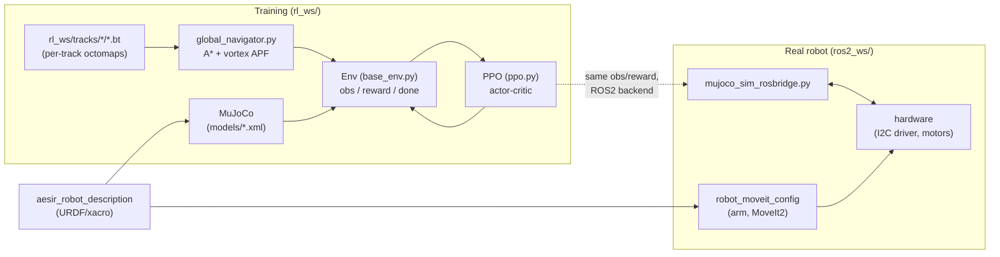

# AESIR — Rescue robot: simulation, RL and control

Repository for the **AESIR** rescue robot: a tracked vehicle with 4 flippers and
a 6-DOF arm. It covers the full development cycle — modeling the robot and
terrains in MuJoCo, training RL (PPO) policies for base locomotion, the arm,
or both, autonomous navigation over terrain, and deployment on the real robot
via ROS2 — all in one place.

> This README is the entry point. Details for each part live in that folder's
> own README (linked below) and, within each script, in its header docstring.

## Objective

Train and validate in simulation (MuJoCo) control policies so AESIR can
traverse uneven terrain (pallets, ramps, steps) using its flippers and
autonomous navigation, and deploy those policies on the physical robot by
reusing the same observation/control pipeline through a ROS2 bridge —
minimizing the sim-to-real gap.

> Note: this description was drafted from the code and commit history. Adjust
> it if it doesn't reflect the project's real objective (e.g. a more specific
> mission or scope — SAR, competition, thesis, etc.).

## Architecture



Two backends share the same task logic (`base_env.py`): `mujoco_sim_base.py`
for fast training (physics in threads, no ROS) and `base_ros_env.py` over
`mujoco_sim_rosbridge.py` to train/validate against the same bridge used with
the real robot.

## Stack

| Layer | Technology |
|---|---|
| Physics simulation | MuJoCo 3.10 |
| RL | PyTorch, custom PPO (actor-critic, no stable-baselines) |
| Navigation | Shapely (A* + vortex/APF potential field), Octomap (`.bt`) |
| Experiment tracking | Weights & Biases |
| Real robot | ROS2 (Humble/Jazzy), MoveIt2, C++ (I2C driver), URDF/Xacro |
| Utilities | NumPy, Matplotlib (path/heatmap visualization) |
| Environment | Python 3.10, venv (`.venv/`) |

## Repository layout

| Folder | Contents | Docs |
|---|---|---|
| `rl_ws/` | RL training: envs, PPO, global navigation, tracks, utilities | [rl_ws/README.md](rl_ws/README.md) |
| `rl_ws/base_training/` | Base (tracks + flippers) training pipeline | [rl_ws/base_training/README.md](rl_ws/base_training/README.md) |
| `models/` | MuJoCo XML models of the robot and terrains (pallets, ramps, steps, flat) | [models/README.md](models/README.md) |
| `ros2_ws/` | ROS2 workspace: robot description, hardware driver, arm MoveIt config | [ros2_ws/README.md](ros2_ws/README.md) |
| `ros2_ws/src/aesir_robot_description/` | URDF/xacro, meshes and launch files for the robot | [README](ros2_ws/src/aesir_robot_description/README.md) |
| `ros2_ws/src/hardware/` | ROS2↔I2C driver (flipper steppers + DC motors) and teleop | [README](ros2_ws/src/hardware/README.md) |
| `ros2_ws/src/robot_moveit_config/` | MoveIt2 configuration for the arm | [README](ros2_ws/src/robot_moveit_config/README.md) |
| `checkpoints_base/`, `checkpoints_nav/`, `rl_ws/checkpoints_*` | Trained policy weights (`.pt`) | — (artifacts, not code) |
| `heatmap_debug/` | Debug output from the elevation heatmap during training | — (artifacts) |
| `pistas_temporal/` | Source material (Blender/exporter) for tracks before conversion to XML/mesh | Not documented yet — looks like working material, not a source of truth |
| `decreped/` | Legacy code predating the current pipeline | Not documented yet (pending decision to archive or remove) |

## Quickstart

### Install dependencies

```bash
bash setup.bash            # auto-detects ROS distro (Humble/Jazzy) and installs everything
# or, forcing a distro:
bash setup.bash humble
```

### Train the base (fast, no ROS — recommended for iterating)

```bash
cd rl_ws
python3 base_training/train_fast.py                                 # config.py defaults
python3 base_training/train_fast.py --n-envs 6 --steps 512 --iters 2000 --wandb
```

### Train/validate against the ROS2 bridge (closer to the real robot)

```bash
# Terminal 1
cd rl_ws && MUJOCO_GL=glfw python3 base_training/mujoco_sim_rosbridge.py
# Terminal 2
cd rl_ws && python3 base_training/train_base.py
```

### Visualize a trained policy

```bash
cd rl_ws
python3 tests/test_base.py --checkpoint checkpoints_base/base_iter00100.pt --episodes 5
```

### Real robot (ROS2)

```bash
cd ros2_ws
colcon build
source install/setup.bash
# see ros2_ws/README.md for the launch order (hardware, description, MoveIt)
```

## Documentation by module

- [docs/phases.md](docs/phases.md) — the project's phases and how the current architecture maps to them
- [rl_ws/README.md](rl_ws/README.md) — full RL workspace
- [rl_ws/base_training/README.md](rl_ws/base_training/README.md) — base training pipeline
- [models/README.md](models/README.md) — MuJoCo models and tracks
- [ros2_ws/README.md](ros2_ws/README.md) — ROS2 workspace
- [ros2_ws/src/aesir_robot_description/README.md](ros2_ws/src/aesir_robot_description/README.md)
- [ros2_ws/src/hardware/README.md](ros2_ws/src/hardware/README.md) — already documented in detail (I2C protocol, node, teleop)
- [ros2_ws/src/robot_moveit_config/README.md](ros2_ws/src/robot_moveit_config/README.md) — already documented in detail (MoveIt2, servo, arm control)

## Convention for new scripts

Every new script should carry a header docstring with: what it does in one
line, what it depends on / who consumes it, and how to run it — the pattern
already used in `rl_ws/base_training/*.py`.

## Open status / notes

- `pistas_temporal/` and `decreped/` aren't documented yet — before writing
  their README it's worth deciding whether to archive them, delete them, or
  treat them as a source of truth.
- Several checkpoint directories (`checkpoints_base/`, `rl_ws/checkpoints_*`)
  are tracked in git even though `.gitignore` ignores `*.pt` — the
  `checkpoints/` pattern doesn't cover `checkpoints_base/` or
  `checkpoints_nav/`. Check whether that's intentional.
