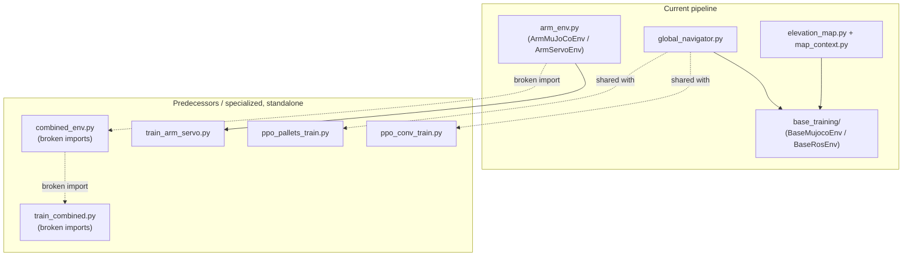

# rl_ws — RL training

## What's here

`rl_ws/` is AESIR's RL training workspace. Two **generations** of code coexist
here, and it's worth telling them apart before touching anything:

- **`base_training/`** — the current pipeline for training the base (tracks +
  flippers): two backends (`BaseMujocoEnv` direct and `BaseRosEnv` over the
  ROS2 bridge) that share the same task logic (`base_env.py`) and the same
  configuration (`config.py`). This is what the root README's quickstart
  uses. Documented in detail in its own README (link below) — this document
  doesn't repeat it.
- **Loose scripts at the root of `rl_ws/`** — each with its own history,
  according to their header docstrings:
  - `ppo_conv_train.py` and `ppo_pallets_train.py` define their own
    self-contained env (`AesirMuJoCoEnv`, `AesirNavEnv`/`AesirPalletsEnv`) and
    their own PPO, without depending on `base_training/`. By name and
    structure they are the **predecessor** of what is today `base_training/`
    (`base_ros_env.py` itself refers to the "original `BaseMuJoCoEnv`" when
    comparing to the ROS version), but nothing in the code explicitly marks
    them as retired — they remain self-sufficient and runnable as-is.
  - `arm_env.py` is a **separate, current** module: it defines the 6-DOF arm
    env (`ArmMuJoCoEnv` for direct MuJoCo, `ArmServoEnv` for the real
    ROS2/MoveIt Servo stack). It isn't a predecessor of anything — it's the
    piece missing from `base_training/` (which only covers the base), and
    it's reused by `combined_env.py`, `train_arm_servo.py`, and
    `train_combined.py`.
  - `combined_env.py` and `train_combined.py` attempt to train the base + arm
    in the same process, but **as of today have broken imports** — see
    [Notes / status](#notes--status).
- **`global_navigator.py`** — global navigation (A* + vortex/APF field),
  literally shared by both `base_training/` backends and by the
  `utils/`/`tests/` scripts (dual import `rl_ws.global_navigator` /
  `global_navigator` depending on where it's run from).
- **`elevation_map.py`** + **`base_training/map_context.py`** — turn an
  octomap (`.bt`) into the egocentric heatmap the policy sees as an
  image-like observation. `elevation_map.py` has the pure geometry (octree →
  grid → rotated patch); `map_context.py` (lives in `base_training/`, but is
  shared) wraps it in a class that loads the `.bt` once and exposes a cheap
  `get_heatmap()` per step.
- **`map_extractor.py`** and **`octomap_from_mujoco.py`** — offline tools to
  generate the static artifacts used by navigation and the heatmap: the first
  exports an `obstacles.json` (pallets/sticks/2D obstacles) from a MuJoCo
  XML; the second generates the `.bt` files in `tracks/`.
- **`tracks/`** — pre-generated maps (occupied/inflated `.bt`, and
  `obstacles.json` for pallets) per track, consumed by `config.TRACK_DEFS`.
- **`utils/`** — visualizers and a URDF→MJCF compilation utility.
- **`tests/`** — a mix of current tests/demos (tied to `base_training/`) and
  old scripts tied to `ppo_pallets_train.py` or to a `path_utils` module that
  no longer exists in the repo — see the table and notes below.
- **`checkpoints_base_mujoco/`**, **`checkpoints_nav/`** — weights (`.pt`)
  from earlier runs, local to `rl_ws/` (distinct from `checkpoints_base/` at
  the repo root, which is where the current pipeline saves).



## Submodules

- `base_training/` — current pipeline for training the base (tracks +
  flippers), two backends (direct MuJoCo / ROS2 bridge), centralized config —
  see [base_training/README.md](base_training/README.md).
- `boton_training/` — arm-only pipeline: 6-DOF arm trained to press buttons on
  a dome tower. Task: reach + press + hold. Uses damped Jacobian IK (matches
  MoveIt Servo), anti-windup torque limiting, PPO (shared with base) — see
  [boton_training/README.md](boton_training/README.md).
- `fsm_training/` — mission pipeline: base and arm on a single MuJoCo world
  (`models/aesir_complete_flat_tower.xml`) sequenced by a fixed phase machine
  (navigate to tower → scripted docking → press → scripted retract → navigate
  to goal). `mission_env.py` (`MissionEnv`), `policies.py` (loads legacy and
  current base checkpoints and the button-arm policy), `legacy_heatmap.py`
  (server heatmap encoding for legacy bases), `train_fsm.py` (per-agent PPO
  fine-tuning under the mission, checkpoints to `checkpoints_fsm/<run>/`) and
  `plot_fsm.py` (plots from `metrics.csv`, usable while training).
  Train: `MUJOCO_GL=egl .venv/bin/python3 rl_ws/fsm_training/train_fsm.py --randomize-tower`.

## Key files

| File | What it does | How it's run / used |
|---|---|---|
| `arm_env.py` | 6-DOF arm + gripper env. `ArmMuJoCoEnv` controls the arm with an end-effector Cartesian twist converted to joint velocity via Jacobian + damped pseudo-inverse (the same computation as MoveIt Servo). `ArmServoEnv` is the same interface (`reset`/`step`/`set_goal`) but against the real ROS2 stack (MoveIt Servo + `ros2_control`), with no cameras/lidar in the observation. Shares `cartesian_twist_to_joint_vel()` with `combined_env.py`. | `from arm_env import ArmMuJoCoEnv` (direct use), or `ArmServoEnv` requires, in other terminals, `ros2 launch robot_moveit_config bringup_viz.launch.py` and the bridge running (see Notes). |
| `boton_env.py` | `BotonArmEnv`: arm-only task (base frozen) pressing buttons on a dome tower. Task-specific: Jacobian computed at TCP (tool_link), not body origin, to match real MoveIt Servo. Anti-windup torque limiting prevents shoulder from breaking wrist against hard contact. Used by `boton_training/train_boton.py` (PPO, parallel envs). | `from boton_env import BotonArmEnv` or `python3 -m boton_training.train_boton` to train. See [boton_training/README.md](boton_training/README.md). |
| `combined_env.py` | `CombinedMuJoCoEnv`: controls base + arm in the same simulation step, in 3 modes (`joint` a single network with 14 actions, `separate` two independent networks, `hierarchical` one frozen policy). Combined action = 2 (drive) + 4 (flippers) + 6 (EE twist) + 2 (fingers). | Broken import in the repo's current state (see Notes / status) — the `from rl_ws.base_ros_env import (...)` block references a module and symbols that no longer exist at that path. |
| `global_navigator.py` | Shared global navigation: A* over the pallets safe zone (`plan_route`) or a direct route with a virtual obstacle over the flat platform (`plan_platform_route_with_obstacle`), plus vortex/APF field tracking (`vortex_apf`, `GlobalNavigator`) with lookahead. All tunable parameters come from `base_training/config.py`. | Imported (`from global_navigator import ...`), not run directly. Used by `base_training/mujoco_sim_base.py` and `base_training/base_ros_env.py` (both backends), plus the `utils/`/`tests/` scripts. |
| `elevation_map.py` | Converts an octomap (`.bt`) into a 2.5D elevation map and exposes: `octree_to_global_elevation()` (once, heavy), `classify_elevation()` (floor/obstacle/gap), `get_egocentric_patch()`/`get_circular_height_heatmap()` (per step, cheap), and `flipper_climb_edge()`/`flipper_terrain_delta()` (real height difference under each flipper, for the climbing reward). | Standalone mode: `python3 elevation_map.py occupied_map.bt --resolution 0.05 [--heatmap\|--height-heatmap] --robot-x .. --robot-y ..` — visualizes the semantic map and an egocentric patch without needing the PPO environment. |
| `map_extractor.py` | Extracts collision geoms from a MuJoCo XML, classifies them (pallet/stick/obstacle/floor/robot/arm by name) and exports `obstacles.json` (pallets, sticks, obstacles, waypoints) plus a top-down PNG view. | `python3 map_extractor.py --xml <path.xml> --export-json obstacles.json [--save map.png] [--only-collision]` |
| `octomap_from_mujoco.py` | Generates a 3D OctoMap from a MuJoCo XML without ROS: rasterizes box-type collision geoms (and meshes, via vertical raycast) into a boolean grid, dumps it to `occupied_map.bt`, and generates `inflated_map.bt` by dilating by the robot's radius. | `python3 octomap_from_mujoco.py --track {flat,steps,ramps,pallets}` (saves to `tracks/<track>/`) or `python3 octomap_from_mujoco.py <xml> --resolution 0.05 --inflate-radius 0.25 --out-raw .. --out-inflated ..` for an arbitrary XML. |
| `ppo_conv_train.py` | Self-contained PPO with a multi-modal CNN policy (`AesirMuJoCoEnv`, `ConvActorCritic`): cameras + lidar + joint_states → 14 actions (drive + 4 flippers + 6 arm joints + 2 fingers). Defines its own `RolloutBuffer` and training loop, without depending on `base_training/`. | `cd rl_ws && MUJOCO_GL=egl python3 ppo_conv_train.py` (or `train(render=False)` imported). Saves to `./checkpoints/`. |
| `ppo_pallets_train.py` | Self-contained navigation PPO through the pallets corridor (`AesirNavEnv`, aliased `AesirPalletsEnv`): reward for geodesic progress toward `GOAL_XY` along the A* route (`global_navigator.plan_route` over `obstacles.json`), penalties for getting stuck/lidar/falling. | `cd rl_ws && python3 ppo_pallets_train.py` (or `train(render=False)`). Saves to `./checkpoints_nav/`. Imported by `tests/test_path.py` and `utils/plot_path.py`. |
| `train_arm_servo.py` | Trains PPO (`MlpActorCritic`, a plain MLP since there are no cameras/lidar via ROS2) against `ArmServoEnv`, i.e. through the real ROS2 stack. Each `step()` blocks for `SERVO_CONTROL_DT` seconds of real time — much slower than direct MuJoCo. Samples a random goal per reset within a box relative to `arm_base_link`. | `cd rl_ws && python3 train_arm_servo.py`. Requires, in other terminals, `ros2 launch robot_moveit_config bringup_viz.launch.py` and the bridge (see Notes — the filename cited in the docstring is outdated). Saves to `./checkpoints_arm_servo/`. |
| `train_combined.py` | Trains base (`BaseRosEnv`) and arm (`ArmServoEnv`) in the same process, alternating `"solo"` iterations (each trains separately) and `"together"` iterations (both `step()` in parallel, in threads, against the same physical instant of the bridge) according to `joint_every`. | Broken import in the repo's current state — `from base_env import BaseRosEnv` doesn't resolve (see Notes / status). |

## Training tracks (`tracks/`)

| Track | Type (`config.TRACK_DEFS`) | Contents |
|---|---|---|
| `flat/` | `platform` | `occupied_map.bt`, `inflated_map.bt` — flat platform, no physical pallets; navigation via direct route + virtual obstacle (no A*). |
| `steps/` | `platform` | `occupied_map.bt`, `inflated_map.bt` — steps. |
| `ramps/` | `platform` | `occupied_map.bt`, `inflated_map.bt` — ramps. |
| `pallets/` | `pallets` | `occupied_map.bt`, `inflated_map.bt`, **`obstacles.json`** — the classic pallets/sticks track; `obstacles.json` (generated by `map_extractor.py`) is what `global_navigator.plan_route()` consumes for A*, and `occupied_map.bt`/`inflated_map.bt` (generated by `octomap_from_mujoco.py`) feed the elevation heatmap. |

`occupied_map.bt` is the "raw" octomap (only the real collision geoms);
`inflated_map.bt` is the version dilated by the robot's radius + safety
margin, meant as a navigation costmap. Both are regenerated with:

```bash
python3 octomap_from_mujoco.py --track flat     # or steps / ramps / pallets
```

which reads the robot-less XML for that track (`_TRACK_XMLS` in the script
itself) and writes directly to `tracks/<track>/`. `pallets/`'s
`obstacles.json` is regenerated separately with `map_extractor.py
--export-json`.

## Local checkpoints

- `checkpoints_base_mujoco/` — `.pt` weights (`base_mujoco_best.pt`,
  `base_mujoco_iter000XX.pt`) from an earlier run of the base pipeline
  against direct MuJoCo. Coexists with `checkpoints_base/` at the repo
  **root**, which is where the current pipeline writes
  (`base_training/config.py: CHECKPOINT_DIR = ROOT/checkpoints_base`) — it's
  unclear from the code whether `checkpoints_base_mujoco/` is still in use or
  is a leftover from an earlier `CHECKPOINT_DIR` setting.
- `checkpoints_nav/` — output directory of `ppo_pallets_train.py`
  (`CHECKPOINT_DIR = Path("./checkpoints_nav")`, relative to CWD); currently
  empty. There's also an empty `checkpoints_nav/` at the repo root for the
  same reason (depends on where the script was launched from).

## Utilities (`utils/`)

| File | What it does |
|---|---|
| `compilation.py` | Loads the robot's URDF (via `path_utils.get_urdf_path`/`get_meshes_dir`), compiles it to MuJoCo and launches the interactive viewer. Depends on a `path_utils` module that doesn't exist in the current repo (see Notes). |
| `generic_visualizer.py` | MuJoCo viewer with auto-reload: relaunches `simulate`/`mujoco.viewer` every time it detects a change in the watched XML (mtime polling). Default XML path hardcoded to a different install location (`/home/aesir/aesir_rl/...`). |
| `plot_path_platform.py` | Visualizes (or tests with `--trials N`) an episode on the `flat`/platform track: replays `BaseMujocoEnv.reset()` (random spawn/goal, direct route + virtual obstacle via `plan_platform_route_with_obstacle`) and simulates the vortex tracking. |
| `plot_path.py` | Navigation-map visualizer + A* route over `obstacles.json`, using `SPAWN_XYZ`/`GOAL_XY` from `ppo_pallets_train.py` (the legacy script) and `global_navigator.plan_route`. |
| `plot_path_vortex.py` | Extends `plot_path.py`: simulates tracking with vortex correction (`GlobalNavigator.step`) from spawn to goal and draws the actual trajectory (solid) against the reference A* route (dashed); optionally draws the vector field (`--field`). Takes spawn/goal/parameters from `base_training/config.py`, not `ppo_pallets_train.py`. Reused by `plot_path_platform.py` and `tests/test_base.py`. |
| `view_octomap.py` | Visualizes in 3D (or 2D top-down if `mplot3d` isn't available) the occupied voxels of a `.bt`, without ROS or octovis. |

## Tests / visualization (`tests/`)

| File | What it checks / does | Status |
|---|---|---|
| `test_base.py` | Runs/visualizes a trained base policy (`.pt`) against `BaseRosEnv` (the same ROS2 pipeline used for training), with a live trajectory plot and a per-term reward breakdown. | Current — tied to `base_training/`. Requires the bridge running separately. |
| `test_fsm.py` | Evaluates the full mission in `MissionEnv` (no ROS) with deterministic or sampled actions and reports per-stage outcomes (`base_to_tower`, `dock`, `arm`, `base_to_goal`). Accepts base + arm checkpoints or an FSM checkpoint from `train_fsm.py`; `--dock teleport` isolates the arm. | Current — tied to `fsm_training/`. |
| `test_path.py` | Checks A* route following with a fallback controller (simple differential kinematics) over `TestEnv(AesirPalletsEnv)`, reports waypoints reached, accumulated reward, and termination cause. | Tied to the legacy env from `ppo_pallets_train.py`, not `base_training/`. |
| `test_sensors.py` | Live OpenCV windows with the 3 cameras + lidar reading (ceiling/front/floor) for manual sensor inspection. | Depends on `path_utils` (module missing from the repo) — can't be run as-is. |
| `test_load.py` | Loads the robot's XML and launches MuJoCo's passive viewer — minimal smoke test that the model compiles. | Depends on `path_utils` (module missing from the repo) — can't be run as-is. |
| `test_teleop.py` | Not an automated test: it's a ROS2 keyboard teleop node (`w/a/s/d` for the base, `t/g/y/h` for front/rear flippers), publishing on `/hardware_node/cmd_vel` and `/commands_hardware`. Uses the same limits (`V_MAX_MPS`/`W_MAX_RADPS`) the trained policy sees, imported from `base_training/config.py`. | Current — tied to `base_training/config.py`. |

`tests/trajectories/` is currently empty (expected output folder for saved
trajectories, none generated yet).

## Notes / status

- **New in this branch:** `boton_training/` submodule provides a packaged arm
  training pipeline (not just a standalone env like `arm_env.py`). Uses the
  same PPO algorithm as the base (imports `compute_gae`, `ppo_update` from
  `base_training.ppo`), same parallelization by threads, same hyperparams.
  Task: arm pressing buttons (precision manipulation). See
  [boton_training/README.md](boton_training/README.md) for details.
- **New in this branch:** SAC (Soft Actor-Critic) added for base locomotion
  alongside PPO. File: `base_training/sac.py` + `train_sac.py`. Why: PPO
  plateaus on base (7–9% success) where signal exists; SAC's off-policy replay
  and reparametrized actions help. Not yet for arm (PPO works there).
- **Three generations of arm training coexist:**
  1. `arm_env.py` / `train_arm_servo.py` — generic arm reaching against real
     ROS2/MoveIt Servo stack
  2. `boton_env.py` / `boton_training/` — specialized arm task (button
     pressing), optimized for precision, packaged training pipeline
  3. `train_combined.py` — attempt to train base + arm together (broken imports
     today)
- **Two generations of base training coexist:**
  `base_training/` is the current pipeline (root README's quickstart); `ppo_conv_train.py`
  and `ppo_pallets_train.py` are self-contained predecessors (their own env +
  their own PPO) still executable but not the recommended path.
- **`combined_env.py` and `train_combined.py` have broken imports in the
  repo's current state** (verified, not an assumption): `combined_env.py`
  does `from rl_ws.base_ros_env import (BaseMuJoCoEnv, TRACK_HALF_WIDTH,
  ...)`, but that module now lives at `rl_ws.base_training.base_ros_env`, and
  none of those names (`BaseMuJoCoEnv`, `TRACK_HALF_WIDTH`, `DRIVE_LEFT`,
  etc.) exist anymore in `base_training/*.py` — `BaseMuJoCoEnv` only appears
  in `base_ros_env.py` comments as a historical reference ("same structure as
  the original `BaseMuJoCoEnv`"). `train_combined.py` does `from base_env
  import BaseRosEnv`, but there's no `base_env.py` at the root of `rl_ws/`,
  and even if there were, `BaseRosEnv` lives in `base_ros_env.py`, not
  `base_env.py`. Both appear to have gone stale after the reorganization into
  `base_training/` (see the "Multiple tracks training — tracks re-org" commit
  and similar ones in the history).
- **Outdated ROS2 bridge paths in several docstrings.** `arm_env.py`
  (`ArmServoEnv`), `train_arm_servo.py` and `train_combined.py` instruct
  running `cd rl_ws && python3 mujoco_ros_bridge.py`, but that file doesn't
  exist in `rl_ws/` — the current bridge is
  `base_training/mujoco_sim_rosbridge.py`. The ROS service `ArmServoEnv`
  expects (`/mujoco_ros_bridge/reset_arm`) *is* implemented there, so the
  flow works once pointed at the right file; only the command quoted in the
  docstrings is stale.
- **`path_utils` doesn't exist in the repo.** `utils/compilation.py`,
  `tests/test_load.py` and `tests/test_sensors.py` import `from path_utils
  import ...`, but there's no `path_utils.py` anywhere in `rl_ws/` or the
  rest of the repo (not even in `decreped/`, which also references it).
  These three files can't run without adding that module.
- **`ppo_conv_train.py` doesn't resolve any XML by default (verified).** Its
  `XML_PATH` tries `../aesir_robot_description/launch/aesir_complete.xml`
  and, if missing, falls back to `aesir_mujoco.xml` next to the script —
  neither path exists in the repo today (the robot description lives in
  `ros2_ws/src/aesir_robot_description/`, with no `aesir_complete.xml`, and
  there's no loose XML in `rl_ws/`). Running it as-is (`python3
  ppo_conv_train.py`) fails building `AesirMuJoCoEnv()`; you need to pass an
  explicit `xml_path=` (e.g. some XML from `models/`) for it to work.
  `ppo_pallets_train.py`, by contrast, does resolve its default
  (`../models/aesir_pallets.xml` exists).
